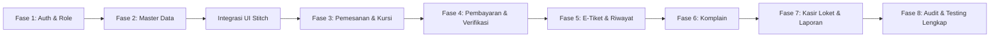

# Roadmap Pengembangan — Lintas Lampung

Dokumen panduan tahapan pengembangan sistem tiket travel antar kota Provinsi Lampung dari awal hingga produksi lokal.

---

## Ringkasan Progres

| Fase | Fokus Modul | Status | Cakupan Utama |
|---|---|:---:|---|
| **Fase 0** | Skema Database & Migrasi | **SELESAI** | 9 tabel relasi, constraint unik, foreign key restrict, seeder data demo |
| **Fase 1** | Fondasi Auth & Role | **SELESAI** | Registrasi member, login fleksibel (username/email), middleware `EnsureRole`, layout dasar |
| **Fase 2** | Master Data Loket | **SELESAI** | CRUD Kota, Rute trayek, Armada kendaraan, Jadwal travel, proteksi integritas relasi |
| **Integrasi** | Template UI Aktor | **SELESAI** | 18 layar UI Stitch (`ui-member-pages`) masuk ke branch kerja, terproteksi routing role |
| **Fase 3** | Pencarian & Pemesanan Kursi | **BERIKUTNYA** | Query jadwal real-time, denah kursi interaktif, anti-double booking, kode unik, expiry job |
| **Fase 4** | Pembayaran & Verifikasi | *Menunggu* | Form bukti bayar member, antrean verifikasi loket, state machine payment |
| **Fase 5** | E-Tiket & Riwayat Pesanan | *Menunggu* | Tiket sah ber-QR, tab status pesanan, validasi akses pemilik tiket |
| **Fase 6** | Layanan Komplain | *Menunggu* | Form aduan penumpang, penanganan tiket oleh operator/admin, balasan solusi |
| **Fase 7** | Kasir Loket Offline & Laporan | *Menunggu* | Kasir walk-in langsung cetak, metrik okupansi rute dan pendapatan |
| **Fase 8** | Verifikasi Akhir & Hardening | *Menunggu* | Full suite Pest tests, audit query N+1, audit otorisasi role, manual end-to-end |

---

## Detail Rencana Eksekusi

---

### Fase 3 — Pencarian & Pemesanan Kursi (Tahap Berikutnya)

Tujuan: Member dapat mencari jadwal nyata, memilih nomor kursi kosong pada mobil, dan mengunci pemesanan.

- **Tugas 3.1: Form Pencarian Beranda Dinamis**
  - Dropdown kota asal dan tujuan mengambil data tabel `cities`.
  - Filter tanggal keberangkatan minimal hari ini.
  - Redirect ke halaman hasil pencarian dengan query parameters.
- **Tugas 3.2: Daftar Jadwal Perjalanan (`member.jadwal`)**
  - Query jadwal berstatus `open` yang berangkat di masa depan.
  - Hitung sisa kursi real-time via `seatsLeft()` dan relasi aktif.
  - Tampilkan nama rute, tipe mobil, plat nomor, harga tiket, dan tombol aksi "Pilih Kursi".
- **Tugas 3.3: Komponen Pemilihan Kursi (`member.kursi`)**
  - Render denah visual 5 kursi mobil penumpang (Avanza/Xenia).
  - Tandai status kursi: *Tersedia*, *Dipilih*, atau *Terisi* (sudah ada booking aktif).
  - Validasi ketat sisi server: tolak jika nomor kursi sudah diambil orang lain pada jadwal sama.
- **Tugas 3.4: Simpan Record Pemesanan**
  - Generate kode tiket unik 12 karakter format `LL` + acak kapital (misal `LL88492011`).
  - Catat `price_snapshot` sesuai harga jadwal saat itu.
  - Set batas bayar `expires_at` otomatis 2 jam dari waktu pemesanan.
  - Status awal booking: `unpaid`.
- **Tugas 3.5: Scheduled Task Expiry Otomatis**
  - Command artisan pengecekan booking `unpaid` yang melewati `expires_at`.
  - Ubah status otomatis menjadi `expired` sehingga kursi kembali terbuka bagi calon penumpang lain.
- **Tugas 3.6: Pengujian Pest**
  - Test skenario pencarian jadwal.
  - Test anti-double booking (dua pengguna memilih kursi sama).
  - Test kalkulasi sisa kursi.

---

### Fase 4 — Pembayaran & Verifikasi Transfer

Tujuan: Member mengunggah bukti bayar, staf loket memvalidasi kebenaran mutasi bank.

- **Tugas 4.1: Instruksi Pembayaran (`member.pembayaran`)**
  - Countdown timer sisa waktu bayar sebelum tiket kedaluwarsa.
  - Detail rekening resmi travel dan total nominal transfer.
- **Tugas 4.2: Konfirmasi Pembayaran (`member.konfirmasi-pembayaran`)**
  - Form input: No Resi/Transaksi, No Rekening Pengirim, Bukti Transfer (file gambar).
  - Simpan record tabel `payments`, ubah status booking menjadi `pending_verification`.
- **Tugas 4.3: Meja Verifikasi Operator (`operator.konfirmasi-pembayaran`)**
  - Antrean pembayaran berstatus `pending`.
  - Modal preview bukti struk transfer.
  - Tombol **Setujui**: payment -> `approved`, booking -> `paid`, catat `verified_by` & `verified_at`.
  - Tombol **Tolak**: payment -> `rejected`, booking kembali ke `unpaid` agar member dapat upload ulang.
- **Tugas 4.4: Pengujian Pest**
  - Test validasi upload file bukti transfer.
  - Test transisi state status booking & payment.
  - Test otorisasi: hanya operator/admin yang berhak menyetujui transfer.

---

### Fase 5 — E-Tiket & Riwayat Pesanan

Tujuan: Member memegang bukti sah perjalanan yang dapat ditunjukkan kepada sopir.

- **Tugas 5.1: Riwayat Pemesanan (`member.pesanan`)**
  - Tab kategori: *Aktif*, *Selesai*, *Batal / Kedaluwarsa*.
  - Menampilkan ringkasan perjalanan, nomor kursi, dan status.
- **Tugas 5.2: Tampilan & Cetak E-Tiket**
  - Kartu tiket berdesain resmi: Kode Booking, Rute, Titik Jemput, Jam Berangkat, Plat Kendaraan, QR Code simulasi.
  - Opsi simpan / print format ramah cetak.
- **Tugas 5.3: Riwayat Transaksi Loket (`operator.pesanan`)**
  - Pencarian transaksi berdasarkan kode booking atau nama pelanggan.
- **Tugas 5.4: Pengujian Pest**
  - Test perlindungan privasi: member dilarang melihat tiket member lain.

---

### Fase 6 — Layanan Komplain & Pengaduan

Tujuan: Saluran aduan kendala layanan (keterlambatan, pendingin rusak, penjemputan meleset).

- **Tugas 6.1: Form Pengajuan Komplain (`member.keluhan`)**
  - Input: Kategori keluhan (layanan, keterlambatan, armada, pembayaran) dan deskripsi detail.
  - Status awal: `open`.
- **Tugas 6.2: Panel Resolusi Petugas (`admin.keluhan` / `operator`)**
  - Daftar komplain masuk.
  - Ubah status (`in_progress`, `resolved`) dan kolom kirim balasan teks resmi.
- **Tugas 6.3: Pengujian Pest**
  - Test alur komplain dari submit hingga balasan terbaca oleh member.

---

### Fase 7 — Kasir Loket Offline & Laporan Eksekutif

Tujuan: Melayani penumpang langsung di kantor loket fisik dan ringkasan performa bisnis.

- **Tugas 7.1: Kasir Loket Walk-in (`operator.layani-pemesanan`)**
  - Pemesanan tiket langsung oleh staf loket untuk penumpang tanpa akun.
  - Status langsung `paid` (metode pembayaran tunai).
- **Tugas 7.2: Dasbor Laporan Admin & Operator**
  - Ringkasan pendapatan per periode.
  - Rute dengan tingkat okupansi kursi tertinggi di Lampung.
- **Tugas 7.3: Pengujian Pest**
  - Test pencatatan transaksi loket offline.

---

### Fase 8 — Verifikasi Akhir, Audit & Hardening

Tujuan: Menjamin aplikasi bebas celah, bebas bug N+1, dan seluruh user story terpenuhi.

- Audit seluruh query Eloquent menggunakan `with()` (cegah N+1).
- Audit proteksi CSRF, Mass Assignment (`#[Fillable]`), dan sanitasi input.
- Menjalankan seluruh test suite Pest dan standardisasi kode via Laravel Pint.
- Verifikasi skenario manual lokal dari awal pendaftaran hingga tiket lunas.

---

*Terakhir diperbarui: 8 November 2026*
