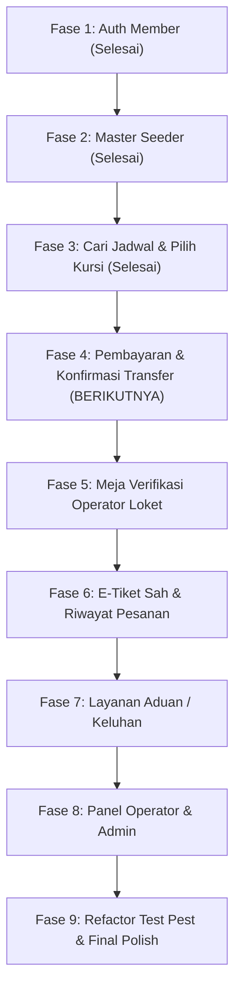

# Roadmap Pengembangan — Lintas Lampung

Dokumen panduan tahapan pengembangan sistem tiket travel antar kota Provinsi Lampung dari awal hingga siap pakai lokal.

---

## Status Terkini & Hasil Audit (12 November 2026)

> [!NOTE]
> Terjadi transisi arsitektur database: Skema awal (Bahasa Inggris: `users`, `cities`, `routes`, `vehicles`, `bookings`, `payments`) telah digantikan oleh skema tabel Bahasa Indonesia (`member`, `kota_asal`, `kota_tujuan`, `kendaraan`, `jadwal`, `pesan`, `konfirmasi_pesan`, `keluhan`, `admin`, `operator_loket`).
> 
> **Pencapaian Baru Selesai**:
> 1. Registrasi member baru masuk ke tabel `member` dan langsung beralih ke halaman login membawa notifikasi flash sukses.
> 2. Autentikasi `Member` aktif via `config/auth.php` dan terhubung ke dashboard `/member/beranda`.
> 3. Seeder data demo travel (`TravelDataSeeder`): 5 kota asal, 5 kota tujuan, 5 mobil, dan 10 jadwal perjalanan aktif.
> 4. Pencarian jadwal travel (`member.cari-jadwal`) membaca tabel `jadwal`, `kota_asal`, dan `kota_tujuan`.
> 5. Alur pemilihan kursi (`member.kursi`) terhubung ke tabel `pesan` (kapasitas 5 kursi, kunci otomatis kursi yang terisi).

---

## Ringkasan Progres

| Fase | Fokus Modul | Status | Cakupan Utama |
|---|---|:---:|---|
| **Fase 0** | Skema Database Bahasa Indonesia | **SELESAI** | 10 tabel DDL (`member`, `kota_asal`, `kota_tujuan`, `kendaraan`, `jadwal`, `pesan`, `konfirmasi_pesan`, dll) |
| **Fase 1** | Registrasi & Login Member | **SELESAI** | Form register -> tabel `member`, redirect login dengan status flash, auth guard member |
| **Fase 2** | Seeder Data Perjalanan | **SELESAI** | 5 Kota Asal, 5 Kota Tujuan, 5 Kendaraan, 10 Jadwal aktif via `TravelDataSeeder` |
| **Fase 3** | Pencarian & Pemesanan Kursi | **SELESAI** | Pencarian jadwal dinamis, visual 5 kursi, validasi kapasitas, simpan ke tabel `pesan` |
| **Fase 4** | Pembayaran & Konfirmasi Pesan | **BERIKUTNYA** | Tampilan tagihan tiket member, upload info resi/rekening ke `konfirmasi_pesan` |
| **Fase 5** | Verifikasi Pembayaran Loket | *Menunggu* | Operator cek bukti transfer, update status pemesanan di tabel `pesan` |
| **Fase 6** | E-Tiket & Riwayat Perjalanan | *Menunggu* | Halaman riwayat tiket member (`pesanan.blade.php`), cetak e-tiket |
| **Fase 7** | Layanan Keluhan Member | *Menunggu* | Form komplain penumpang ke tabel `keluhan`, panel tindak lanjut operator/admin |
| **Fase 8** | Adaptasi Operator & Admin Loket | *Menunggu* | Login terpisah / multi-auth (`operator_loket`, `admin`), CRUD master data jadwal |
| **Fase 9** | Perbaikan Suite Testing Pest | *Menunggu* | Refactor 71 unit/feature test agar selaras dengan skema tabel database baru |

---

## Alur Implementasi Berkelanjutan

---

## Detail Rencana Eksekusi Mendatang

### Fase 4 — Pembayaran & Konfirmasi Transfer (Fokus Berikutnya)
Tujuan: Setelah penumpang memilih nomor kursi, sistem menampilkan ringkasan tagihan dan penumpang dapat mengonfirmasi transfer pembayaran.

- **Tugas 4.1: Halaman Pembayaran (`member.pembayaran`)**
  - Tampilkan rincian pesanan terakhir member: rute, jadwal, nomor kursi, jenis mobil, tarif.
  - Tampilkan nomor rekening resmi loket (Bank Mandiri, BCA, BRI) dan batas waktu pembayaran.
  - Tombol aksi menuju konfirmasi pembayaran.
- **Tugas 4.2: Formulir Konfirmasi Transfer (`member.konfirmasi-pembayaran`)**
  - Form input: Nomor Resi (`no_resi`), Nomor Rekening Pengirim (`no_rek`), Tanggal Transfer, Jam Transfer, Bukti Transfer.
  - Simpan data ke tabel `konfirmasi_pesan`.
  - Update status tiket di tabel `pesan` menjadi `'Menunggu Konfirmasi'`.

---

### Fase 5 — Verifikasi Pembayaran Oleh Operator Loket
Tujuan: Petugas loket memverifikasi keabsahan dana transfer.

- **Tugas 5.1: Daftar Antrean Konfirmasi (`operator.konfirmasi-pembayaran`)**
  - Tampilkan daftar pembayaran masuk yang status pesanannya belum terverifikasi.
  - Rincian: No Resi, Nama Member, Jadwal, Nominal.
- **Tugas 5.2: Aksi Persetujuan / Penolakan**
  - Tombol **Verifikasi Sah**: status pesanan diubah menjadi `'Lunas'`.
  - Tombol **Tolak**: status pesanan dikembalikan atau dibatalkan jika bukti tidak valid.

---

### Fase 6 — E-Tiket & Riwayat Pesanan Member
Tujuan: Penumpang memiliki bukti sah tiket perjalanan antar kota di Lampung.

- **Tugas 6.1: Riwayat Pemesanan (`member.pesanan`)**
  - Tampilkan daftar perjalanan yang dipesan member berdasarkan filter status: *Aktif*, *Selesai*, *Menunggu Pembayaran*.
- **Tugas 6.2: Pratinjau & Cetak Tiket**
  - Render kartu e-tiket resmi lengkap dengan ID Pesan, rute, nama penumpang, kursi, dan waktu keberangkatan.

---

### Fase 7 — Layanan Keluhan Penumpang
Tujuan: Penumpang dapat menyampaikan aduan terkait perjalanan.

- **Tugas 7.1: Form Pengajuan Keluhan (`member.keluhan`)**
  - Input: Jenis keluhan (`j_keluhan`), Detail keluhan (`d_keluhan`).
  - Simpan ke tabel `keluhan` berelasi dengan `id_member`.
- **Tugas 7.2: Monitor Keluhan Petugas Loket / Admin**
  - Daftar aduan masuk untuk segera ditindaklanjuti oleh loket operasional.

---

### Fase 8 — Adaptasi Panel Operator & Admin
Tujuan: Loket dan admin dapat mengelola jadwal serta memantau operasional.

- **Tugas 8.1: Multi-Auth Guard Loket & Admin**
  - Autentikasi untuk tabel `operator_loket` dan `admin`.
- **Tugas 8.2: Manajemen Jadwal & Armada**
  - Form tambah/ubah jadwal keberangkatan travel baru ke tabel `jadwal`.

---

### Fase 9 — Refactor Test Suite Pest & Final Hardening
Tujuan: Memastikan seluruh pengujian otomatis (71 tests) kembali hijau 100%.

- Sesuaikan model, factories, dan HTTP assertions pada test suite Pest agar mencocokkan skema tabel database baru (`member`, `jadwal`, `pesan`).
